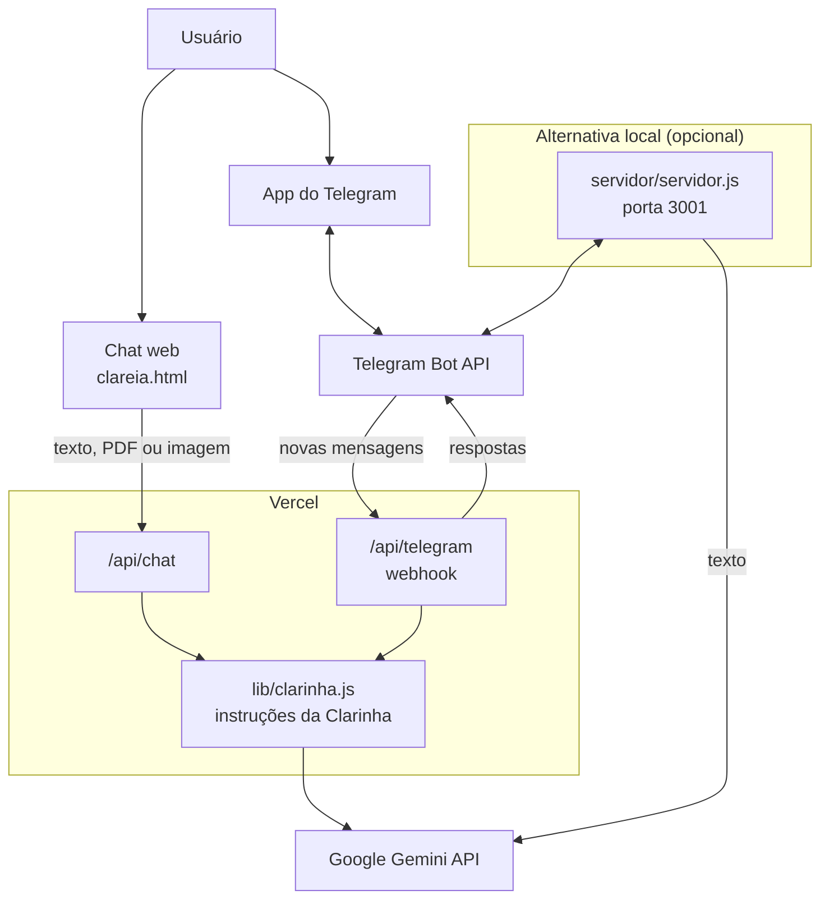
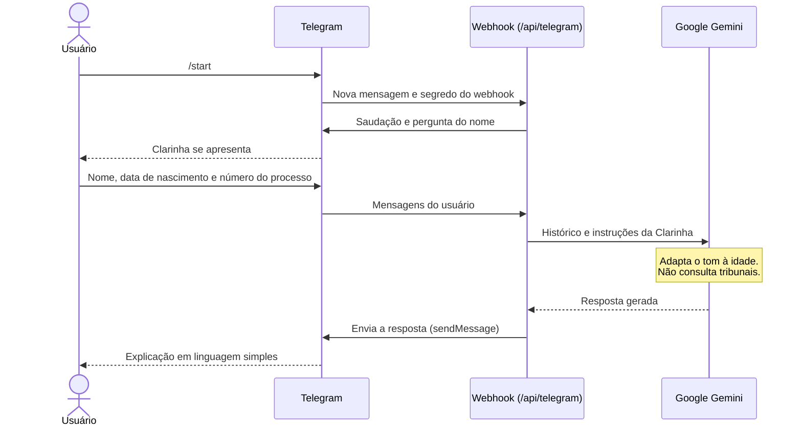
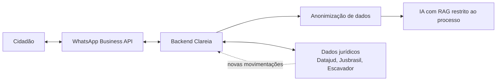

<div align="center">
  
</div>

# Clareia

**Legaltech acadêmica que usa inteligência artificial para traduzir o "juridiquês" para a linguagem do dia a dia.** A assistente virtual Clarinha conversa com a pessoa pelo chat da web ou pelo Telegram, adapta o tom à idade dela e explica documentos processuais enviados em PDF ou imagem.

**[Testar o protótipo](https://clareia1.vercel.app/clareia.html)** · **[Conhecer a startup](https://clareia1.vercel.app/startupclareia.html)** · **[Ver o pitch](https://clareia1.vercel.app/sr2.html)** · **[Ler o relatório de validação](https://clareia1.vercel.app/analisepesquisa.html)**

> [!NOTE]
> **Projeto acadêmico.** A Clareia foi desenvolvida em 2026 como atividade da disciplina de **Empreendedorismo** na **CESAR School**, em Recife. É um MVP criado para validar uma ideia de negócio, não um produto em produção. As respostas da assistente **não substituem a orientação de um advogado**.

## Sumário

- [Visão Geral](#visão-geral)
- [Funcionalidades](#funcionalidades)
- [Arquitetura da Solução](#arquitetura-da-solução)
- [Tecnologias](#tecnologias)
- [Estrutura do Repositório](#estrutura-do-repositório)
- [Como Executar Localmente](#como-executar-localmente)
- [Deploy](#deploy)
- [Variáveis de Ambiente](#variáveis-de-ambiente)
- [Segurança e Limitações](#segurança-e-limitações)
- [Validação com Usuários](#validação-com-usuários)
- [Modelo de Negócio](#modelo-de-negócio)
- [Contexto Acadêmico e Equipe](#contexto-acadêmico-e-equipe)

## Visão Geral

### O que é o Clareia

A Clareia é uma proposta de startup jurídica (*legaltech*) cuja interface é uma conversa. Em vez de ler termos técnicos, a pessoa fala com a **Clarinha**, uma assistente representada por uma coruja, e recebe uma explicação simples sobre o que aconteceu no processo e o que esperar em seguida.

Este repositório reúne o protótipo funcional, as páginas de apresentação do negócio e os materiais de validação produzidos durante a disciplina.

### Qual problema resolve

Acompanhar um processo judicial é difícil para quem não é da área. Expressões como "Juntada de Petição" ou "Concluso para Despacho" geram insegurança e fazem o cidadão depender do advogado até para entender o básico. Do outro lado, os escritórios gastam tempo repetindo as mesmas explicações.

O projeto organiza esse problema em três dores:

| Dor | Quem sente | Como aparece |
|---|---|---|
| **Barreira linguística** | Cidadão | O "juridiquês" exclui quem não tem formação jurídica |
| **Ansiedade constante** | Cidadão | Incerteza sobre prazos e resultados |
| **Gargalo no atendimento** | Advogados e escritórios | Tempo gasto explicando o que é básico |

### Quem pode utilizar

- **Cidadãos com processos em andamento (B2C):** o público principal são pessoas das classes C, D e E, a partir de 25 anos, com foco inicial em Recife (PE). As perguntas típicas são "Ganhei ou perdi?" e "Quando recebo?".
- **Advogados e escritórios (B2B):** público previsto no modelo de negócio, para reduzir a carga de atendimento. Ainda não há funcionalidade específica para eles no código.

### Benefícios da plataforma

- **Clareza:** troca o vocabulário técnico por explicações em português simples.
- **Tom adequado:** ajusta a linguagem à idade da pessoa, de descontraída a formal e paciente.
- **Previsibilidade:** a assistente é instruída a dizer se há motivo para preocupação e qual é o tempo médio esperado.
- **Sem instalar nada novo:** funciona em um aplicativo de mensagens que a pessoa já conhece.

## Funcionalidades

Esta seção separa o que o código realmente faz do que é apenas proposta, porque as páginas de apresentação descrevem também a visão futura do produto.

### ✅ Implementadas

**Clarinha na web ([`clareia.html`](clareia.html))**

- Chat em uma tela que imita um celular, ligado ao Google Gemini por um endpoint do próprio projeto.
- Atendimento em etapas: nome, data de nascimento e, por fim, número do processo ou documento.
- Adaptação do tom de voz à idade informada.
- Envio de **PDF ou imagem de até 3 MB** para o modelo explicar o conteúdo em linguagem simples.
- Histórico mantido durante a conversa, somente na memória da página.
- Novas tentativas automáticas em caso de falha na chamada à API, com espera progressiva.

**Clarinha no Telegram**

- Bot [`@Clareira_Juridico_bot`](https://t.me/Clareira_Juridico_bot), com comando `/start` e sessões separadas por conversa.
- Dois modos de execução: um webhook publicado na Vercel, que não depende de nenhuma aba aberta, ou um servidor Node.js local com painel de liga/desliga.
- Recebe somente texto. Ao receber um arquivo, responde que a leitura de documentos só está disponível na web.

**Apresentação e validação**

- Landing page da startup, com problema, solução, público, Lean Canvas, preços e equipe.
- Pitch interativo em formato de slides, com navegação por teclado.
- Relatórios com os resultados da pesquisa de validação do MVP.
- Formulário de avaliação (Google Forms) e botão de contato pelo WhatsApp na página do protótipo.
- Galeria de imagens para copiar a tag HTML dos recursos visuais do projeto.

### 🎭 Simuladas

| Recurso | Como funciona hoje |
|---|---|
| **Consulta do processo pelo número** | Não há nenhuma consulta a tribunais. O texto é gerado pelo modelo de IA, e a mensagem "Vou consultar no sistema..." é apenas uma encenação. **O status informado pode ser inventado.** |
| **Atendimento no WhatsApp** | Existe apenas a aparência de WhatsApp no pitch ([`sr2.html`](sr2.html)), com conversa e dados de tribunal fixos, e um botão de contato (`wa.me`). Não há integração com a API do WhatsApp. |

> [!IMPORTANT]
> O WhatsApp é o canal central da proposta de negócio e aparece nos materiais de validação, mas o canal automatizado implementado neste repositório é o **Telegram**.

### 🔮 Planejadas (somente visão de produto)

Estes recursos são citados nas páginas e nos relatórios, mas **não existem no código**:

- Monitoramento automático de tribunais (PJe, ESAJ e PROJUDI) e dados via Datajud, Jusbrasil ou Escavador.
- Notificações automáticas sobre novas movimentações e alertas de pendências.
- WhatsApp Business API oficial.
- Arquitetura multiagente e RAG restrito aos dados do processo.
- Anonimização de dados antes do envio à IA.
- Integração SaaS para escritórios, marketplace de leads e antecipação de créditos.

## Arquitetura da Solução

A solução é formada por **páginas estáticas e funções serverless na Vercel**. As funções guardam as credenciais em variáveis de ambiente e fazem a ponte com as APIs externas. Não há banco de dados.



### Frontend

- **Páginas:** HTML, CSS e JavaScript puro, sem etapa de build, usando Tailwind CSS via CDN.
- **Protótipo:** [`clareia.html`](clareia.html) concentra a interface do chat e chama apenas `/api/chat`.
- **Relatório interativo:** aplicação separada em React e Vite, em [`relatorio_clareia/relatorio-clareia/`](relatorio_clareia/relatorio-clareia/). Seus dados estão fixos no próprio código.

### Backend

**Publicado na Vercel:**

| Arquivo | Função |
|---|---|
| [`api/chat.js`](api/chat.js) | Valida a conversa do chat web, aplica um limite por minuto e consulta o Gemini |
| [`api/telegram.js`](api/telegram.js) | Recebe as mensagens do bot, confere o segredo do webhook e envia as respostas |
| [`lib/clarinha.js`](lib/clarinha.js) | Guarda as instruções da Clarinha e faz a chamada ao Gemini |

**Somente para uso local:**

| Arquivo | Porta | Função |
|---|---|---|
| [`server.js`](server.js) | 3000 | Serve os arquivos da pasta, reutiliza `api/chat.js` e oferece uma API de imagens com Multer |
| [`servidor/servidor.js`](servidor/servidor.js) | 3001 | Executa o bot do Telegram com um painel em React. Envia ao Gemini apenas a mensagem atual e o número da etapa |

### Serviços externos

| Serviço | Uso | Situação |
|---|---|---|
| **Google Gemini** | Geração de respostas e leitura de PDF e imagem | Em uso |
| **Telegram Bot API** | Recebimento de mensagens por webhook e envio das respostas | Em uso |
| **Vercel** | Hospedagem das páginas e das funções serverless | Em uso |
| **Google Forms e Google Docs** | Pesquisa de avaliação e entregas da disciplina | Em uso (por links) |
| **WhatsApp (`wa.me`)** | Link de contato | Em uso (apenas link) |
| **Groq** | Exemplo de alternativa de IA em [`codigo_apis/script.txt`](codigo_apis/script.txt) | Não conectado a nenhuma página |

### APIs

**Publicadas na Vercel:**

| Método | Rota | Descrição |
|---|---|---|
| `POST` | `/api/chat` | Recebe `{ contents }` e devolve `{ text }` com a resposta da Clarinha. Também disponível com `server.js` |
| `POST` | `/api/telegram` | Webhook do bot. Exige o cabeçalho `X-Telegram-Bot-Api-Secret-Token` |

**Somente com `server.js` em execução:**

| Método | Rota | Descrição |
|---|---|---|
| `GET` | `/api/images` | Lista as imagens da pasta `uploads/` |
| `POST` | `/api/upload` | Recebe um arquivo no campo `image` e o salva em `uploads/` |
| `GET` | `/uploads/<arquivo>` | Entrega um arquivo enviado |

**Do painel (somente com `servidor/servidor.js` em execução):**

| Método | Rota | Descrição |
|---|---|---|
| `GET` | `/` | Abre o painel de controle |
| `POST` | `/api/toggle` | Liga ou desliga o bot |

**Externas consumidas:**

- Gemini: `generateContent`
- Telegram: `sendMessage` e `sendChatAction`, além de `setWebhook` e `deleteWebhook` na configuração e `getUpdates` no modo local

### Fluxo de dados

O diagrama mostra uma conversa no Telegram. No chat web o fluxo é parecido: a página envia o histórico para `/api/chat` e exibe a resposta.



**Onde os dados ficam:** não há banco de dados. O histórico do chat web fica na memória da página. O do bot fica na memória da função serverless ou do processo Node.js, então a Clarinha pode esquecer a conversa quando a função for reiniciada. A única gravação em disco é a de imagens enviadas por `POST /api/upload`, na pasta `uploads/`.

### Arquitetura pretendida (visão de produto)

O diagrama abaixo resume a proposta descrita nas páginas de negócio e **ainda não foi construído**.



## Tecnologias

| Camada | Tecnologias |
|---|---|
| **Páginas** | HTML5, CSS3, JavaScript, Tailwind CSS (CDN), Lucide, Phosphor Icons, Font Awesome, Google Fonts |
| **Relatório interativo** | React 19, Vite 8, Tailwind CSS 3, Lucide React, ESLint |
| **Servidor** | Funções serverless em Node.js e, no uso local, Express 5, Multer 2 e o módulo nativo `http` |
| **Inteligência artificial** | Google Gemini (padrão `gemini-3.8-flash`, configurável por variável de ambiente) |
| **Mensageria** | Telegram Bot API |
| **Hospedagem e versionamento** | Vercel, Git e GitHub |

**Dependências:** o [`package.json`](package.json) da raiz lista Express e Multer como dependências de desenvolvimento, e suas dependências internas como dependências diretas. Por isso, use a instalação padrão (`npm ci`), sem omitir as de desenvolvimento. O relatório interativo tem um `package.json` próprio.

## Estrutura do Repositório

O repositório funciona também como hospedagem de arquivos do autor, então guarda conteúdo além da Clareia na mesma pasta raiz.

```text
clareia1/
├── clareia.html               # Protótipo: chat web
├── api/
│   ├── chat.js                # Endpoint do chat web
│   └── telegram.js            # Webhook do bot do Telegram
├── lib/
│   └── clarinha.js            # Instruções da Clarinha e chamada ao Gemini
├── scripts/
│   └── configurar-telegram.js # Liga ou remove o webhook do bot
├── .env.example               # Modelo das variáveis de ambiente
├── vercel.json                # Tempo máximo das funções na Vercel
├── startupclareia.html        # Landing page da startup
├── sr2.html                   # Pitch interativo com chat simulado
├── analisepesquisa.html       # Relatório da pesquisa de validação
├── index.html, index2.html    # Galerias de imagens do projeto
├── server.js                  # Servidor local: site, chat e API de imagens
├── package.json               # Dependências do servidor local
├── servidor/
│   └── servidor.js            # Bot do Telegram com painel local
├── codigo_apis/
│   └── script.txt             # Exemplo de uso de Groq e Gemini (não conectado)
├── relatorio_clareia/
│   ├── designsitem.html       # Análise da validação (página estática)
│   └── relatorio-clareia/     # Relatório interativo em React e Vite
├── relatorio.html             # Cópia do código JSX do relatório (não é uma página renderizável)
├── uploads/                   # Imagens recebidas por server.js
└── *.png, *.jpg               # Logos, mockups e fotos
```

<details>
<summary><strong>Outras páginas, sem relação direta com o produto</strong></summary>

<br>

Estas páginas compartilham a mesma hospedagem, mas não fazem parte do funcionamento da Clareia:

- **Estudos e disciplinas:** `adm_dados.html`, `analise_visualizacao.html`, `estatistica1.html`, `probabilidade_estatistica.html`, `lgpd.html`, `marketing.html`, `negociosdigitais.html` (usa a Clareia como estudo de caso).
- **Portfólio e carreira:** `portifolio.html`, `entrevista_emprego.html`, `fh.html`, `jair.html`, `edmilson.html`.
- **Outras atividades e projetos:** `casasbahia.html`, `desafio_SC.html`, `folhapagamento.html`, `studioanaalcantara.html`, `dashboard_eleicoes_2026.html`.

</details>

## Como Executar Localmente

### Pré-requisitos

- [Git](https://git-scm.com/)
- [Node.js](https://nodejs.org/) 20.12 ou superior, para o carregamento automático do `.env` (os passos foram conferidos com a versão 20.19)
- Chave própria da API do Gemini e token próprio de bot do Telegram, somente se quiser testar a IA ou o bot

### 1. Baixar o projeto

```bash
git clone https://github.com/leonidasprof/clareia1.git
```

```bash
cd clareia1
```

### 2. Configurar as credenciais

```bash
cp .env.example .env
```

Preencha o `.env` com os seus próprios valores (veja [Variáveis de Ambiente](#variáveis-de-ambiente)). Esse arquivo é ignorado pelo Git. Sem `GEMINI_API_KEY`, o site abre normalmente, mas o chat responde com uma mensagem de erro de conexão.

### 3. Iniciar o site e o chat

```bash
npm ci
```

```bash
npm start
```

Depois, abra <http://localhost:3000/clareia.html>. A página inicial (`/`) mostra a galeria de imagens.

### 4. Iniciar o bot do Telegram (opcional)

```bash
node servidor/servidor.js
```

Abra <http://localhost:3001> e clique em **LIGAR SERVIDOR**. O modo local não recebe mensagens enquanto o webhook estiver ativo. Para usá-lo com o mesmo bot, remova o webhook antes:

```bash
node --env-file=.env scripts/configurar-telegram.js --remover
```

### 5. Iniciar o relatório interativo (opcional)

```bash
cd relatorio_clareia/relatorio-clareia
```

```bash
npm ci
```

```bash
npm run dev
```

O Vite mostrará no terminal o endereço local, normalmente <http://localhost:5173>.

## Deploy

O projeto é publicado na **Vercel**, em <https://clareia1.vercel.app>, com páginas estáticas e as funções da pasta `api/`.

| Página | Endereço |
|---|---|
| Galeria de imagens | [`/`](https://clareia1.vercel.app/) |
| Protótipo | [`/clareia.html`](https://clareia1.vercel.app/clareia.html) |
| Landing page | [`/startupclareia.html`](https://clareia1.vercel.app/startupclareia.html) |
| Pitch | [`/sr2.html`](https://clareia1.vercel.app/sr2.html) |
| Relatório de validação | [`/analisepesquisa.html`](https://clareia1.vercel.app/analisepesquisa.html) |

Para publicar uma cópia:

1. Importe o repositório na Vercel.
2. Escolha o preset **Other**, sem comando de build.
3. Mantenha a raiz do repositório como diretório de saída.
4. Em **Settings > Environment Variables**, cadastre as [variáveis de ambiente](#variáveis-de-ambiente) e publique o projeto.
5. Ligue o bot ao webhook, uma única vez, usando um `.env` local com o mesmo token e o mesmo segredo:

```bash
node --env-file=.env scripts/configurar-telegram.js https://seu-site.vercel.app
```

**Observações:**

- O [`vercel.json`](vercel.json) define apenas o tempo máximo das funções. As demais configurações ficam no painel da Vercel.
- Os servidores `server.js` e `servidor/servidor.js` não rodam na publicação, então `/api/images` retorna 404 no site.
- A Vercel limita o tamanho de cada envio a 4,5 MB, por isso o chat aceita arquivos de até 3 MB.
- O relatório em React precisa ser publicado à parte. Gere os arquivos com `npm run build` e use a pasta `dist/`.

## Variáveis de Ambiente

As credenciais ficam fora do código. Localmente, elas vão no arquivo `.env`, criado a partir do [`.env.example`](.env.example). Na Vercel, são cadastradas no painel do projeto.

| Variável | Obrigatória | Finalidade |
|---|---|---|
| `GEMINI_API_KEY` | Sim | Chave da API do Google Gemini |
| `TELEGRAM_BOT_TOKEN` | Para o bot | Token do bot, gerado no BotFather |
| `TELEGRAM_WEBHOOK_SECRET` | Para o webhook | Segredo criado por você, com letras, números, `_` e `-`, que autentica as chamadas do Telegram |
| `GEMINI_MODEL` | Não | Troca o modelo sem alterar o código. O padrão é `gemini-3.8-flash` |

**Nunca faça commit do `.env`** nem coloque esses valores em arquivos servidos ao navegador.

## Segurança e Limitações

O projeto é um MVP acadêmico e **não deve receber dados reais ou sensíveis** no estado atual.

| Ponto de atenção | Situação atual | Correção recomendada |
|---|---|---|
| **Credenciais antigas** | Foram retiradas dos arquivos e passaram para variáveis de ambiente, mas continuam no histórico do Git | Revogar todas as credenciais antigas e usar somente valores novos |
| **Uso abusivo do chat** | `/api/chat` é público e tem apenas um limite simples por instância, o que pode consumir a cota do Gemini | Adicionar autenticação ou limite compartilhado, e definir alertas de uso |
| **Status de processo pode ser inventado** | A resposta sobre um número de processo é gerada sem consulta a dados reais | Consultar uma fonte oficial ou informar claramente que é uma simulação |
| **LGPD** | As páginas prometem dados "blindados" e criptografia de ponta a ponta, mas o código não implementa isso. Mensagens e documentos são enviados ao Google e, no bot, passam pelo Telegram | Adequar o texto, informar o tratamento dos dados e aplicar a anonimização prevista |
| **Upload sem restrições** | `POST /api/upload` não exige login e não limita tipo ou tamanho do arquivo | Autenticar, validar o tipo e limitar o tamanho |
| **Arquivos expostos pelo servidor** | `server.js` serve toda a pasta do projeto, inclusive o código-fonte | Servir somente uma pasta pública |
| **Texto sem tratamento no chat** | As mensagens são inseridas na página como HTML sem sanitização | Escapar o conteúdo antes de exibir |
| **Memória do bot** | O histórico fica na memória da função e pode se perder quando ela é reiniciada | Guardar as sessões em um armazenamento persistente |

**O que foi conferido nesta documentação:** instalação e início de `server.js`, `GET /api/images`, build do relatório em React, endpoints e chat web com o Gemini e o Telegram simulados. **Não foram testadas** a publicação das funções na Vercel, as respostas reais do Gemini e do Telegram, nem o upload de imagens.

## Validação com Usuários

A equipe fez um teste de usabilidade do MVP, seguido de entrevista estruturada, com **15 participantes** que tinham processos ativos e dificuldade para compreendê-los. A análise dos dados é de abril de 2026. O objetivo era responder a três perguntas: a tradução é clara para leigos, as pessoas confiam no canal e a informação reduz a ansiedade?

| Indicador | Resultado | O que mede |
|---|---|---|
| Adoção do canal | **100%** | Conforto com a interface do WhatsApp |
| Eficácia da tradução | **86,7%** | Consideraram a linguagem da IA perfeitamente clara |
| Queda de ansiedade | **66,7%** | Relataram redução da ansiedade com as previsões |
| Necessidade de prova | **53,3%** | Fariam uma checagem do advogado antes de confiar na indicação |

**Principais aprendizados**

- A familiaridade com o aplicativo de mensagens elimina a curva de aprendizado.
- A coruja foi considerada infantil para temas sérios, o que levou à proposta de um rebranding.
- Os usuários confiam, mas verificam: querem provas sociais antes de aceitar a indicação de um advogado.
- Digitar o número do processo é difícil, o que motivou o envio de documentos por foto ou PDF, hoje disponível no chat web.

> [!NOTE]
> A amostra é pequena e serve como indício para orientar o produto, não como resultado estatisticamente conclusivo. A faixa etária também varia entre os materiais (26 a 50 anos em um, 25 a 60+ em outro). Os resultados completos estão no [relatório de validação](https://clareia1.vercel.app/analisepesquisa.html).

## Modelo de Negócio

Os valores abaixo são hipóteses do Lean Canvas. **Não há cobrança implementada.**

| Segmento | Oferta | Preço proposto |
|---|---|---|
| **B2C:** cidadãos | Consulta avulsa ou assinatura | R$ 19,90 por consulta |
| **B2B:** escritórios de advocacia | Integração SaaS para automatizar o atendimento | A partir de R$ 249 por mês |

**Possibilidades de expansão:** marketplace de leads jurídicos, antecipação de créditos de sentenças ganhas (comissão estimada de 5% a 10%) e marketplace de serviços pós-causa, como contadores e peritos.

**Oportunidade apontada:** segundo os materiais do projeto, com base no CNJ (2023), o Brasil tem mais de 80 milhões de processos ativos.

## Contexto Acadêmico e Equipe

| | |
|---|---|
| **Instituição** | CESAR School, Recife (PE) |
| **Disciplina** | Empreendedorismo |
| **Curso citado nas páginas** | Gestão de TI (GTI) |
| **Ano** | 2026 |

| Integrante | Papel (conforme o protótipo) | Foco |
|---|---|---|
| **Danilo** | Product Owner | Produto e estratégia |
| **Leônidas** | Scrum Master / Dev Full Stack | Desenvolvimento, negócio e validação |
| **Aynoã** | Dev / Scrum Team | Infraestrutura lógica de sistemas |
| **Beatriz** | Dev / Scrum Team | Pesquisa e UX |
| **Cauã** | Dev / Scrum Team | Desenvolvimento |
| **Marcela** | Dev / Scrum Team | Conteúdo e documentação |

Os títulos variam entre as páginas: a landing page e o pitch apresentam a equipe com cargos de startup, como CEO e Tech Lead.

### Entregas da disciplina

Documentos mantidos no Google Drive. O acesso depende das permissões definidas pela equipe.

<details>
<summary><strong>Entregas principais</strong></summary>

<br>

1. [Desafios, Lacunas, Tendências e Oportunidades](https://docs.google.com/document/d/1jPh4tPRbGIyhn0uMnEQga1RjDIHX9fukNgtmucodBvs/edit)
2. [Achados Iniciais](https://docs.google.com/document/d/1zuiOksBWL82Az_hUZSfOAIxv2AiWJF7X5ZJONYCCorQ/edit)
3. [Pessoas, Causas e Consequências](https://docs.google.com/document/d/1XcOZV5DdjYliKFlmpASwNO-oYV4h1yNVHH5mw7DfMOA/edit)
4. [Pessoas, Causas e Consequências](https://docs.google.com/document/d/1PxhRM3rwETDrPEQzmXVVD1HgWpBLSTpcLhXdDWdDbNY/edit)
5. [Relevância e Justificativa](https://docs.google.com/document/d/1dapsC-dyeLIp6ImZ8O0BZnovX5KjR-w023hd6g6qw3M/edit)
6. [Estratégias](https://docs.google.com/document/d/1JpPsJMZ2kfZaqBMP2dlION23Z2-K9m4-RZddZ58HCZo/edit)
7. [Lean Startup Canvas](https://docs.google.com/document/d/15ZeyKM65RLLNpukTn0Voys1dwpnwLMhNPJYvrVmySaU/edit)

</details>

<details>
<summary><strong>Ferramentas aplicadas</strong></summary>

<br>

- [Documentação Clareia (resumo de atividades)](https://docs.google.com/document/d/1VB_dwNjBdZnA03zHqgo-wdPH28ak0wp2/edit)
- [Concepção do Problema: Atividade 1](https://docs.google.com/presentation/d/1jH2RfZ9KGZ9-Ur0S5DHvunnWOZYPUMFmZ0MkCGhXiKQ/edit)
- [Problema Escolhido](https://docs.google.com/document/d/10nIbRiLLxDES455vkAKkTSe0LAviUUkN0pAavI758_Q/edit)
- [Análise PESTEL](https://docs.google.com/document/d/1YXvfN49Oi_YypMhjAG8QpY2QwNc_b_X3CqanKjX-aRU/edit)
- [Matriz RACI](https://docs.google.com/document/d/1LF20WRdugNx955lf6nq3NjOlbMhKJwMUjxSa9lDxFn8/edit)
- [JTBD, Opportunity Statement e Elevator Pitch](https://docs.google.com/document/d/1nU65qJiMn8zWUzz4YUxWwsvX65VBXPFoKOChNlykQoc/edit)
- [Benchmark Estratégico](https://docs.google.com/document/d/1W4ZOeE5_sNn9oLyey8eNmca7Sr3mM9QGitaJi6Evj9Q/edit)
- [Entendendo o Fluxo Clareia](https://docs.google.com/presentation/d/1itX3tP5d5XeXoIGkb7N2IG4J4zdJIKso1kcAnbYQUK4/edit)
- [Storytelling Clareia](https://docs.google.com/document/d/1uk7cWyt04tNjLu4Q0VfH8lDQ9giLn-GK/edit)
- [Mapa de Empatia](https://docs.google.com/presentation/d/1k0LN0o-p_0x2fqFDW1_cJTs11qjEOYvjLzDdV2nGjzQ/edit)
- [Modelo de Receita](https://docs.google.com/document/d/1MvwBEitOUAuYwBOO0CL8z2A9TznyFWb9PUItfv3EsIQ/edit)
- [Lean Canvas](https://docs.google.com/presentation/d/1BRsAS3A_MEq-A46Ubk2KyK8GIBhuF-HiRqMsledH0Xc/edit)

</details>

---

Este repositório não inclui um arquivo de licença, e as páginas do projeto indicam "Todos os direitos reservados". Consulte a equipe antes de reutilizar o conteúdo.
