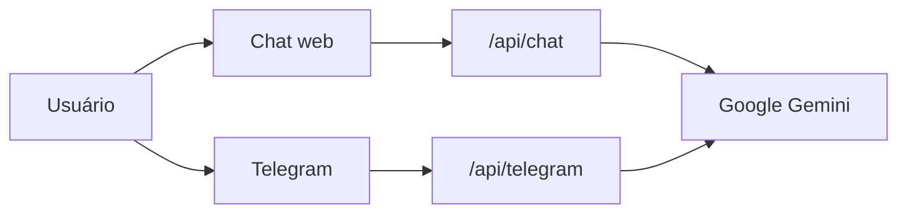

<div align="center">
  
  <h1>Clareia</h1>
  <p><strong>Assistente com IA que traduz o "juridiquês" para quem tem um processo na Justiça.</strong></p>
  <p>
    <a href="https://clareia1.vercel.app/clareia.html">Testar o protótipo</a> ·
    <a href="https://clareia1.vercel.app/sr2.html">Ver o pitch</a> ·
    <a href="https://clareia1.vercel.app/analisepesquisa.html">Ler a pesquisa</a>
  </p>
</div>

## Sobre o projeto

Termos como "Concluso para Despacho" deixam muita gente insegura e dependente do advogado até para entender o básico. A Clareia responde a esse problema com a **Clarinha**, uma assistente de conversa que explica documentos processuais em linguagem simples e adapta o tom à idade de cada pessoa.

MVP de startup criado em equipe em 2026, na disciplina de Empreendedorismo da **CESAR School**.

## Resultados

Teste de usabilidade com **15 pessoas**, seguido de entrevista:

- **86,7%** consideraram a linguagem da IA perfeitamente clara.
- **66,7%** relataram menos ansiedade em relação ao processo.
- A dificuldade de digitar o número do processo no celular motivou o envio de documentos por foto ou PDF.

## O que funciona hoje

- **Chat na web** com respostas geradas pelo Google Gemini
- **Leitura de PDF e imagem** enviados na conversa
- **Linguagem adaptada** à idade informada pela pessoa
- **Bot no Telegram** ([@Clareira_Juridico_bot](https://t.me/Clareira_Juridico_bot)), somente com mensagens de texto

**Ainda não implementado:** consulta real a tribunais e integração com o WhatsApp. Por isso, as respostas sobre um número de processo são apenas demonstrativas. O projeto não substitui a orientação de um advogado.

## Tecnologias

- **Front-end:** HTML, CSS, JavaScript, Tailwind CSS, React e Vite (relatório de resultados)
- **Back-end:** Node.js, funções serverless e Express (ambiente local)
- **Integrações:** Google Gemini API e Telegram Bot API
- **Deploy:** Vercel

## Como funciona



As chaves de API ficam apenas no servidor, em variáveis de ambiente. Para manter o MVP simples, não há banco de dados: as conversas ficam em memória e podem se perder quando a página ou o servidor reinicia.

## Como executar

Requer Node.js 20.12 ou superior e uma chave própria do Gemini.

```bash
git clone https://github.com/leonidasprof/clareia1.git
cd clareia1
npm ci
cp .env.example .env
```

Preencha `GEMINI_API_KEY` no arquivo `.env`, execute `npm start` e abra <http://localhost:3000/clareia.html>.

## Equipe

Aynoã, Beatriz, Cauã, Danilo (Product Owner), Leônidas (Scrum Master e Dev Full Stack) e Marcela.
